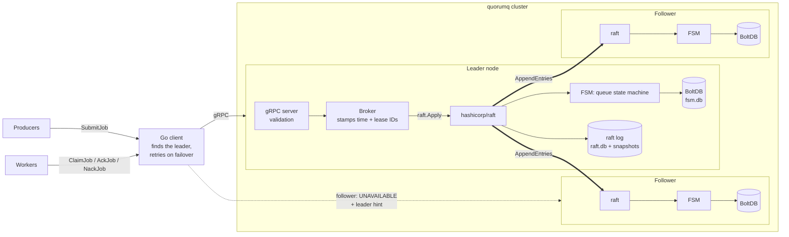
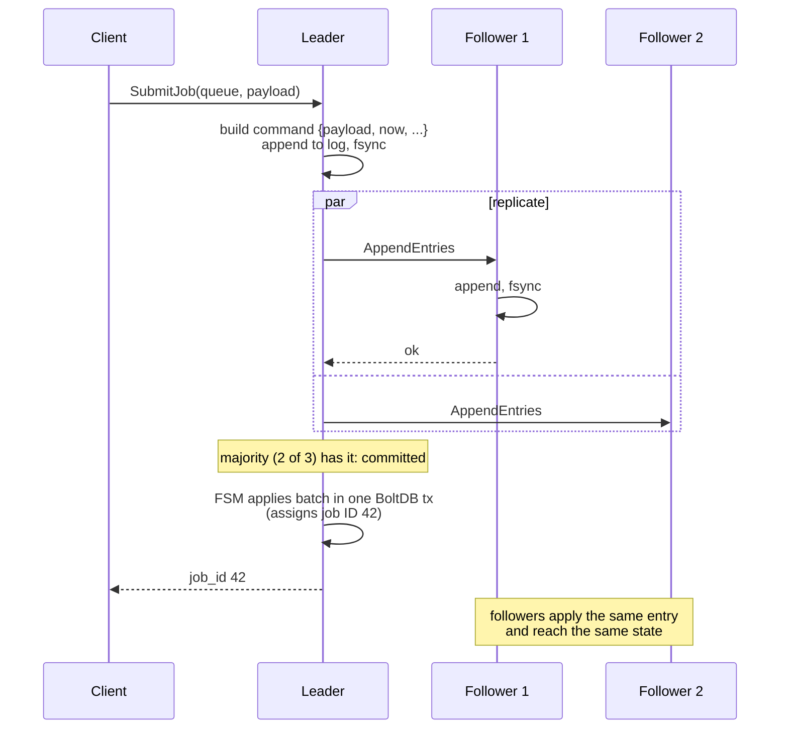
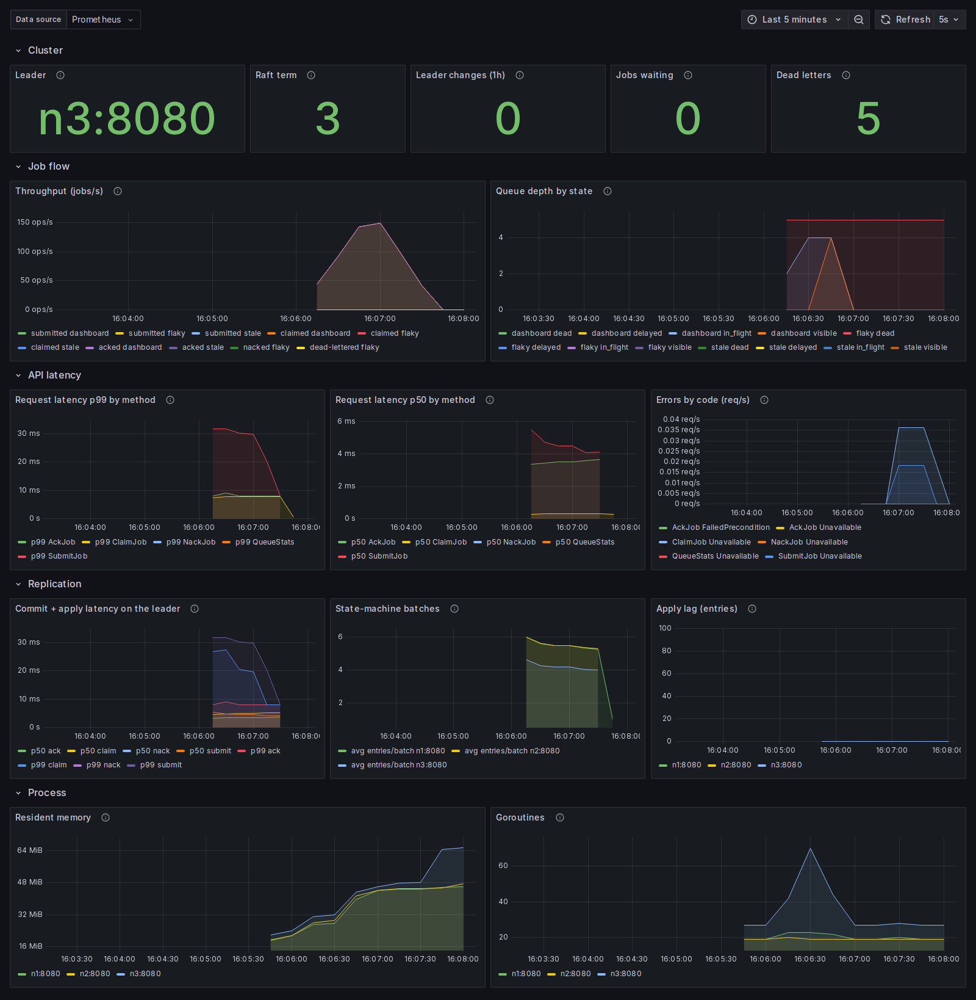

# quorumq

[](https://github.com/arvindxyogesh/quorumq/actions/workflows/ci.yml)

A fault-tolerant distributed job queue in Go: a small, production-style take on
Amazon SQS or a Celery broker. Producers submit jobs, workers claim, process and
acknowledge them, and a cluster of brokers keeps every acknowledged job safe
through the crash of any minority of nodes, including the leader.

```
quorumq submit -queue emails -payload '{"to":"a@example.com"}'   -> job 42
quorumq claim  -queue emails -worker w1 -visibility 30s          -> job 42, lease 9f3c...
quorumq ack    -job 42 -lease 9f3c...                            -> done
```

> **Measured** (2-vCPU sandbox, every node and the load generator on one machine):
> **0 of 534,247** acknowledged jobs lost, including **10 forced leader kills** under
> load; leader failover in a median **1.33 s**; under a real 2|3 network partition
> the minority side acknowledged **0 of 2,298** writes; **1,348 jobs/s** end to end
> on a 3-node cluster with p99 submit-to-ack latency of **94 ms** at 500 jobs/s.
> Details and caveats in [Results](#results).

## Contents

- [The problem](#the-problem)
- [Architecture](#architecture)
- [Design decisions and tradeoffs](#design-decisions-and-tradeoffs)
- [What happens during a network partition](#what-happens-during-a-network-partition)
- [Limitations](#limitations)
- [Results](#results)
- [Running it](#running-it)
- [Testing](#testing)
- [Operations](#operations)
- [Repository layout](#repository-layout)

## The problem

A job queue sits between the code that creates work (a web request that needs
an email sent, an upload that needs thumbnails) and the workers that do it. Its
promises matter more than its speed:

1. **No acknowledged job is lost.** Once `SubmitJob` returns, the job survives
   broker crashes, including the crash of the node that accepted it.
2. **Every job is eventually processed.** If a worker dies mid-job, the job is
   handed to someone else.
3. **A job is not processed twice at the same time** by two healthy workers,
   and a worker that lost its claim cannot mark someone else's work as done.
4. **Failures are contained.** A job that keeps failing is retried with
   backoff and then parked in a dead-letter queue instead of looping forever.

A single broker with a database meets 2-4 but not 1: the broker is a single
point of failure. quorumq replicates the queue across 3 or 5 brokers with Raft
so that (1) holds while a majority is up.

## Architecture



A submit, step by step:



Every node holds a full copy of every queue. Only the leader serves requests;
followers replicate and stand by.

| Path | Role |
| --- | --- |
| `internal/queue` | The deterministic state machine: queues, leases, retries, dead letters, snapshots, on BoltDB |
| `internal/cluster` | Raft node, `raft.FSM` adapter, the Raft-backed broker, admin HTTP |
| `internal/server` | gRPC `QueueService`: validation, error-code mapping, leader redirects |
| `client` | Go client library |

## Design decisions and tradeoffs

### Why Raft, and why hashicorp/raft

The requirement is that an acknowledged submit survives the loss of the node
that acknowledged it, with no manual failover. That needs replication with an
automatic, safe leader election, which is consensus. The alternatives:

- **Primary-backup with asynchronous replication** (Redis-style) is faster but
  loses whatever the primary acknowledged and had not yet shipped when it died.
  That breaks promise 1.
- **Delegating durability to a database** (Postgres with `SELECT ... FOR UPDATE
  SKIP LOCKED`) is a great production choice, but it moves the hard part into
  the database and its own failover story. The point here is to own it.
- **Raft** commits an entry only once a majority has it on disk, and only a node
  holding every committed entry can be elected leader. So any acknowledged write
  survives any minority failure, and a new leader never forgets one.

`hashicorp/raft` (Consul, Nomad, Vault) handles elections, log replication,
snapshots and log compaction; etcd's raft library is lower level and leaves
transport and storage to the caller. Its `BatchingFSM` interface lets the queue
apply up to 64 committed entries in one BoltDB transaction, so one fsync covers
many writes.

### A deterministic state machine

Raft guarantees every node applies the same commands in the same order. That
only yields identical replicas if applying a command is deterministic, so the
state machine never reads the clock or a random source:

- The leader stamps each command with the current time and, for claims, a random
  lease ID *before* proposing it. Replicas replaying the log later use those
  values, not their own clocks.
- Job IDs come from a counter stored in the state machine, not a UUID.
- State-machine time never moves backwards: each command's time is raised to the
  latest time already applied. After a failover to a node whose clock runs a
  little behind, existing leases are not suddenly extended or shortened.
- Retry backoff settings travel inside the nack command, so replicas compute the
  same delay even if their configuration differs.

### At-least-once, not exactly-once

quorumq delivers each job **at least once**. Exactly-once delivery is not
achievable end to end without the worker's side effects taking part in the
protocol: a worker can finish the work and crash before its ack arrives, and the
queue cannot tell that apart from a worker that crashed before doing anything.
Duplicates can arise in three places, all deliberate:

1. A worker is slower than its visibility timeout. The job is redelivered to
   another worker. Its lease ID makes the slow worker's late ack fail
   (`FAILED_PRECONDITION`), but its side effects already happened.
2. A claim commits but the response is lost in a failover. The job sits leased to
   nobody until its visibility timeout expires, then is redelivered.
3. A submit commits but the leader crashes before replying. The client retries
   on the new leader and the job is enqueued twice.

The standard remedy is idempotent handlers (a dedupe key in the worker's own
database). A client-supplied idempotency key on `SubmitJob` would remove case 3
and is the natural next feature.

### Visibility timeouts and lease IDs

A claim does not delete the job; it hides it until `now + visibility_timeout` and
issues a lease ID. Each queue is a BoltDB index sorted by `(visible_at, job_id)`,
so:

- a claim takes the first key and checks `visible_at <= now`; the oldest-visible
  job wins (FIFO by visibility time);
- claiming moves the key forward by the timeout, and an expired lease is already
  at the front of the index. **No background reaper exists**: expiry is
  discovered by the next claim, so the state machine only changes in response to
  log entries;
- `AckJob(job_id, lease_id)` succeeds only if `lease_id` is the job's current
  lease. A lease stays valid until the job is re-claimed, not until a clock says
  so, so a slightly late ack still counts when nobody else has taken the job.
  Retrying an ack or nack with the same lease is a no-op, so clients can retry
  them freely across a failover.

### Retries, backoff and the dead-letter queue

A nack hides the job for `base * 2^(attempt-1)` (default 1s doubling to 5 min)
and records the reason. A job may be delivered `max_retries + 1` times; after
the last attempt is nacked, or its lease expires, it moves to the queue's
dead-letter queue. A poison message therefore stops consuming workers, and an
operator can inspect it (`ListDeadJobs`, with `last_error`) and `RedriveJob` it
once the bug is fixed.

### Persistence, restart and snapshots

Each node keeps the Raft log (`raft.db`), periodic snapshots, and the state
machine itself (`fsm.db`). The state machine records the index of the last log
entry it applied **in the same BoltDB transaction as the change**, so the two
cannot disagree after a crash. On restart Raft replays only the log after that
point and already-applied entries are skipped, the same idea as etcd's
"consistent index". Snapshots bound log growth: after `-snapshot-threshold`
entries Raft snapshots the state machine (a consistent BoltDB copy taken under
a read transaction, while writes continue) and truncates the log. A follower
that falls behind the truncated log is sent the snapshot instead. A node that
loses `fsm.db` rebuilds from its newest snapshot plus the log.

### Reads, redirects and empty polls

- **Writes** go through `raft.Apply` on the leader and return after commit and
  apply.
- **Reads** (`GetJob`, `QueueStats`, `ListDeadJobs`) issue a Raft barrier first.
  It only succeeds if a majority still accepts this node as leader, so a leader
  cut off by a partition cannot serve stale data. The ReadIndex optimisation
  would avoid the log write and is a possible improvement.
- **Followers** reject requests with gRPC `UNAVAILABLE` and a standard
  `google.rpc.ErrorInfo` naming the leader. The client follows the hint,
  rotates through its address list when a node is unreachable, backs off with
  jitter, and caps each attempt so a hung node cannot consume the whole
  deadline. Forwarding requests between servers was the alternative; redirects
  are simpler and cannot loop.
- **Empty claims** are answered from the leader's local state without touching
  the log. Polling an idle queue would otherwise cost a quorum fsync per poll.
  The shortcut can only produce a spurious "empty" (which a poller retries),
  never hand out a job outside the log.

## What happens during a network partition

Take five nodes split 3 | 2, with the old leader on the minority side.

- **Majority side (3 nodes):** followers stop hearing heartbeats, one times out,
  wins an election with 3 of 5 votes and serves requests. Clients that can reach
  it fail over to it.
- **Minority side (2 nodes):** the old leader cannot reach a majority. Writes it
  accepts never commit; the client sees a timeout or `UNAVAILABLE` and retries
  elsewhere. After the leader lease timeout it steps down, and reads fail because
  their barrier cannot commit. **Nothing is acknowledged on the minority side**,
  so there is no split brain.
- **When the partition heals:** the old leader sees the higher term and becomes a
  follower. Any uncommitted entries in its log are overwritten by the new
  leader's log; none of them were acknowledged to a client.
- **Effects clients can see:** unavailability for clients that only reach the
  minority, and possible duplicates from retried submits and claims (see
  at-least-once above). Leases are timestamps inside the replicated state, so
  they keep expiring on the majority side, and jobs held by workers on the wrong
  side of the partition are redelivered once their visibility timeout passes.

With 3 nodes the cluster tolerates 1 failure; with 5, 2.

**Tested, not just argued.** `TestPartitionMinorityLeader` partitions a 5-node
cluster in-process (a fault-injecting stream layer under Raft's real TCP
transport) and runs in CI. `scripts/partition.sh` does it to a real Docker
cluster under load by dropping packets with iptables inside each container's
network namespace, while sending writes and reads straight to the minority
nodes with `quorumq -no-retry`. In three 30-second partitions the minority
acknowledged **0 of 2,298 writes** and served **0 of 2,298 reads**, the old
leader was a candidate (not leader) throughout, the majority acknowledged its
first write 1.8-2.5 s after the cut, no write sent to the minority survived
healing, and the load lost **0 of 40,902** jobs. See
[`bench/results/sandbox-partition-20261020`](bench/results/sandbox-partition-20261020/summary.md).

## Limitations

These are deliberate scope cuts for a portfolio project:

- **One Raft group for everything.** Every queue goes through one leader, so
  throughput is bounded by a single node and one log. Scaling out would mean
  sharding queues across several Raft groups.
- **Static membership.** The cluster is configured with `-peers`; adding or
  removing nodes at runtime (Raft's `AddVoter`/`RemoveServer`) is not exposed.
- **Acked jobs are kept forever** so `GetJob` keeps working; there is no
  retention or compaction of finished jobs, and the database only grows.
- **`QueueStats` and the metrics collector scan a queue's index** (O(jobs
  waiting)). Fine at these sizes; maintained counters would scale better.
- **Workers poll.** There is no long-polling; idle workers sleep and retry.
- **No authentication or TLS** on gRPC or Raft traffic.
- **Commands are JSON in the log.** Simple to read and debug; protobuf would be
  smaller and faster.
- **Duplicate submits are possible** after a leader crash (no idempotency keys).
- **Benchmarks ran on one small machine** with every node and the load generator
  sharing its 2 vCPUs; see below.

## Results

All numbers below were produced by `scripts/bench.sh` and rendered into
[`bench/results/sandbox-20261020/summary.md`](bench/results/sandbox-20261020/summary.md)
from the raw files next to it. Lost-job counts were rechecked independently by
`scripts/reconcile.sh` from the per-job ID files.

**Environment.** Intel Xeon @ 2.10 GHz, **2 vCPUs**, 7 GiB RAM, Linux 6.18,
Docker 29.9, Go 1.24.7, commit `2b42709`. All nodes and the load generator ran
on that one machine: nodes in Docker containers on a bridge network with host
port mapping, data on Docker named volumes, every write fsynced. Payloads were
256 bytes. The image was `FROM scratch` with the same statically linked
`quorumq-server` binary the Dockerfile builds (the sandbox could not pull the
Dockerfile's base images; CI builds and tests the real image).

| Measurement | Configuration | Result |
| --- | --- | --- |
| End-to-end throughput, 1 node | closed loop, 32 producers / 64 workers, 3 runs x 30 s | **2,349 jobs/s** (median; range 2,227-2,412) |
| End-to-end throughput, 3 nodes | same | **1,348 jobs/s** (1,238-1,350) |
| End-to-end throughput, 5 nodes | same | **938 jobs/s** (880-951) |
| Submit-to-ack latency, 3 nodes | fixed 500 submits/s for 60 s | **p50 48.2 ms, p95 72.5 ms, p99 93.9 ms** (max 135.9) |
| Leader failover time | 10 `docker kill`s of the leader, 15-25 s apart, under 300 submits/s | **median 1,329 ms** (957-1,524) |
| Jobs lost across 10 leader kills | 92,452 acknowledged submits | **0** (55 duplicate deliveries) |
| Minority writes acknowledged during a network partition | 5 nodes split 2\|3 with the leader on the minority side, 3 runs x 30 s | **0 of 2,298** (reads served: 0 of 2,298) |
| Partition: majority's first acknowledged write after the cut | same | **1.8-2.5 s** |
| Partition: jobs lost | 40,902 acknowledged submits under load | **0** |
| Jobs lost, all runs | 575,149 acknowledged submits | **0** |

Latency under the closed-loop throughput runs (median of 3 runs):

| Nodes | p50 (ms) | p95 (ms) | p99 (ms) |
| --- | --- | --- | --- |
| 1 | 44.3 | 69.6 | 81.2 |
| 3 | 71.1 | 112.2 | 128.1 |
| 5 | 112.6 | 174.2 | 208.7 |

**Definitions.**
*Throughput* is jobs whose ack completed during the 30 s window, divided by
30 s; every job costs three committed writes (submit, claim, ack).
*Submit-to-ack latency* runs from the start of `SubmitJob` to the end of the
worker's successful `AckJob` for that job, so it includes two queue hops and
three quorum commits.
*Failover time* runs from `docker kill` of the leader to the first acknowledged
`SubmitJob`, measured by `quorumq-load probe` retrying every 10 ms.
*Lost* is an acknowledged submit whose job no worker ever completed.

**How to read these numbers.**

- **Throughput falls as nodes are added here because they share 2 vCPUs and one
  disk.** Each extra replica adds another fsync and another copy of the work on
  the same hardware. On separate machines a follower costs the leader network
  fan-out rather than CPU, so this trend overstates the cost of replication;
  that setup was not measured.
- **Failover of about 1-1.5 s** is mostly failure detection: followers wait for
  a 500 ms heartbeat timeout plus a randomised election timeout before voting,
  then the new leader commits its first entry. Shorter timeouts would fail over
  faster at the price of spurious elections on a busy network.
- **Duplicates are the price of at-least-once delivery.** 55 of 92,452 jobs in
  the chaos run were delivered twice: claims or acks whose responses were lost
  in a failover (redelivered after the 5 s lease) and submits retried after a
  leader crash.

Reproduce with `docker build -t quorumq:dev . && scripts/bench.sh`.

## Running it

Requires Go 1.27+; Docker for the cluster scripts; `jq` and `curl` for the
scripts.

```sh
make test          # unit tests with -race, including in-process 3-node Raft clusters
make integration   # 3 real server processes; SIGKILLs the leader twice mid-stream
make demo          # one node: submit, claim, ack, nack + backoff, timeout, dead letters, redrive
```

### Locally with Docker Compose (3 nodes)

```sh
make cluster-up                      # gRPC on localhost:7071-7073, admin HTTP on :8081-8083
go run ./cmd/quorumq -addr localhost:7071,localhost:7072,localhost:7073 submit -queue emails -payload hi
go run ./cmd/quorumq -addr localhost:7071,localhost:7072,localhost:7073 stats -queue emails
curl -s localhost:8081/status        # role, term, leader, log indexes
make failover-demo                   # docker kill the leader, check no job is lost
make observability-up                # plus Prometheus (:9090) and Grafana with the dashboard (:3000)
make cluster-down
```

The CLI takes any subset of node addresses and finds the leader itself.

### Without Docker

```sh
go build -o bin/ ./cmd/...
PEERS=n1=127.0.0.1:7001/127.0.0.1:7071,n2=127.0.0.1:7002/127.0.0.1:7072,n3=127.0.0.1:7003/127.0.0.1:7073
for i in 1 2 3; do
  bin/quorumq-server -node-id n$i -raft-addr 127.0.0.1:700$i -addr 127.0.0.1:707$i \
    -http-addr 127.0.0.1:808$i -peers $PEERS -data-dir data/n$i &
done
```

### On Kubernetes

A 3-replica StatefulSet with a headless Service for peer DNS, a client
Service, and a PodDisruptionBudget that keeps a quorum during drains:

```sh
docker build -t quorumq:dev . && kind load docker-image quorumq:dev   # or push to your registry
kubectl apply -k deploy/k8s
kubectl port-forward svc/quorumq 7070 &
go run ./cmd/quorumq -addr localhost:7070 stats -queue demo
```

Pods start in parallel (`podManagementPolicy: Parallel`): with ordered startup,
pod 0 would wait to become ready, readiness needs a leader, and a leader needs a
quorum of pods, so the cluster would never start.

CI deploys these manifests to a kind cluster on every change
(`scripts/k8s-smoke.sh`): it waits for the StatefulSet, does a CLI round trip
inside the cluster, runs a load Job, force-deletes the leader pod mid-run and
fails if any acknowledged job is lost.

### Benchmarks and chaos

```sh
docker build -t quorumq:dev .
scripts/bench.sh                     # writes bench/results/<run>/ and summary.md
go build -o bin/ ./cmd/...           # or drive the pieces by hand:
scripts/cluster.sh up 3
bin/quorumq-load run -addr $(scripts/cluster.sh addrs) -producers 32 -workers 64 -duration 30s
scripts/chaos.sh 5 10 20 kills.jsonl # kill the leader 5 times, 10-20s apart, timing each failover
sudo scripts/partition.sh out/ 30     # 5 nodes, 2|3 network partition for 30s (needs root for iptables)
```

### Configuration

| Flag | Default | Meaning |
| --- | --- | --- |
| `-node-id`, `-peers` | `n1`, single node | Cluster membership: `id=raftAddr/clientAddr,...` |
| `-addr`, `-raft-addr`, `-http-addr` | `:7070`, `:7000`, `:8080` (loopback) | gRPC, Raft and admin listeners |
| `-data-dir` | `./data` | Raft log, snapshots and queue state |
| `-retry-backoff`, `-retry-backoff-max` | `1s`, `5m` | Nack backoff: doubles per failed attempt, capped |
| `-snapshot-threshold`, `-trailing-logs` | `8192`, `10240` | When to snapshot, and how much log to keep after |

## Testing

| Layer | What is checked |
| --- | --- |
| State machine (`internal/queue`) | FIFO, visibility timeouts, lease checks and idempotent ack/nack, backoff, dead-lettering, redrive, idempotent log replay, monotonic time, snapshot/restore, concurrent claims never double-deliver |
| Cluster (`internal/cluster`) | Real 3-node Raft clusters in one process: replication, redirects, committed jobs surviving leader loss, no re-apply after restart, a lagging follower installing a snapshot, rebuilding after losing `fsm.db`, stale acks rejected through Raft, empty claims not writing to the log, `/metrics` |
| Client | Leader hints, skipping dead nodes, deadlines, no retries on application errors |
| Partitions (`internal/cluster`) | 5 nodes split 2\|3 with the leader on the minority: no minority write acknowledged, old leader steps down and refuses reads, majority elects a newer-term leader, all replicas converge to exactly the acknowledged jobs; isolated follower catches up |
| Integration (`test/integration`) | 3 real processes, 2000 jobs, the leader SIGKILLed twice mid-stream: every acknowledged submit processed, replicas converge |
| Chaos (`scripts/chaos.sh`) | Docker cluster under load, the leader container killed repeatedly, every submit reconciled |
| Partition (`scripts/partition.sh`) | Real 2\|3 network partition of a Docker cluster under load via iptables |
| Kubernetes (`scripts/k8s-smoke.sh`, CI) | kind cluster: `kubectl apply -k deploy/k8s`, in-cluster load Job, leader pod force-deleted mid-run, 0 jobs lost |
| Grafana (`scripts/grafana-check.sh`, CI) | Compose with Prometheus and Grafana: every dashboard query returns data through Grafana's data source |

All Go tests run with the race detector in CI, on the Go version in `go.mod`
and the latest stable release.

## Operations

Each node serves `/healthz` (liveness), `/readyz` (ready once it knows a
leader), `/status` (Raft role, term, log indexes) and `/metrics` on its admin
port; the gRPC health service reports `quorumq.v1.QueueService` the same way as
`/readyz`. The Grafana dashboard (`deploy/grafana`) shows the leader, job
throughput, queue depth by state, latency percentiles by method, errors by
code, commit latency, FSM batch sizes and apply lag.



*Taken by CI on a GitHub Actions runner while `scripts/grafana-check.sh` drove
a 3-node Compose cluster at ~200 jobs/s for 45 s, with a few dead letters,
redirected requests and a rejected stale ack. The same job runs every
dashboard query through Grafana's data source and fails if any returns no
data; that check caught two dashboard bugs before this screenshot.*

| Metric | What it tells you |
| --- | --- |
| `quorumq_jobs_{submitted,claimed,acked,nacked,dead_lettered,redriven}_total{queue}` | Job flow, counted by the node that served it |
| `quorumq_queue_jobs{queue,state}` | Depth by state: `visible`, `in_flight`, `delayed`, `dead` |
| `quorumq_grpc_request_duration_seconds{method}`, `quorumq_grpc_requests_total{method,code}` | API latency and errors |
| `quorumq_raft_apply_duration_seconds{op}` | Leader-side time to commit a command to a quorum and apply it |
| `quorumq_fsm_apply_batch_{entries,duration_seconds}` | Log entries per BoltDB transaction |
| `quorumq_raft_is_leader`, `quorumq_raft_leader_changes_total`, `quorumq_raft_term`, `quorumq_raft_index{kind}` | Leadership and replication progress |

## Repository layout

| Path | What it is |
| --- | --- |
| `api/quorumq/v1` | Protobuf API and generated code (`make proto` regenerates with buf) |
| `internal/queue` | Deterministic BoltDB state machine |
| `internal/cluster` | Raft node, FSM adapter, Raft-backed broker, admin HTTP |
| `internal/broker` | Single-process broker (tests), retry policy, shared errors |
| `internal/server` | gRPC service implementation |
| `internal/metrics` | Prometheus metrics and scrape-time collector |
| `internal/loadgen` | Load generator and failover probe |
| `client` | Go client library |
| `cmd/quorumq-server`, `cmd/quorumq`, `cmd/quorumq-load` | Broker, CLI, load generator |
| `test/integration` | Process-level failover test |
| `scripts` | Demo, cluster, chaos and benchmark scripts |
| `deploy` | Docker Compose, Kubernetes, Prometheus and Grafana |
| `bench/results` | Raw benchmark output and generated summaries |
